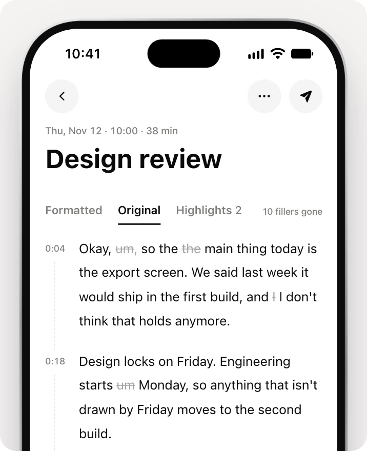
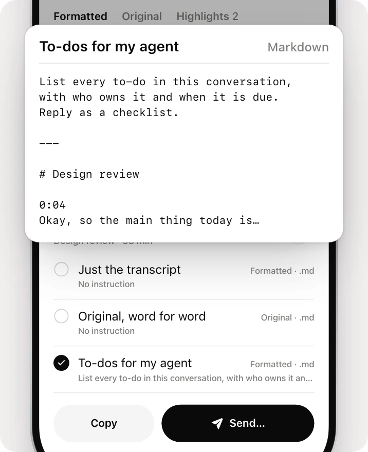

<p align="center">
  <picture>
    <source media="(prefers-color-scheme: dark)" srcset="brand/logo/final/wordmark-dark.svg">
    
  </picture>
</p>

<p align="center">
  <b>The recorder you already own.</b><br>
  Tap the dot on your Apple Watch. Clean, titled transcripts land on your iPhone.
</p>

<p align="center">
  <a href="LICENSE"></a>
  
  
  
  
  
</p>

<p align="center">
  <picture>
    <source media="(prefers-color-scheme: dark)" srcset=".github/readme/record-dark.avif">
    
  </picture>
</p>

jotto turns the Apple Watch you already have into an everyday recorder. There's no new gadget to buy and nothing to set up: tap the dot on your wrist and talk. Your iPhone turns what it hears into clean text, names the recording, and keeps it ready to search, highlight and send on. There is no account and no server. Everything runs on your devices, unless you choose to bring your own API key.

jotto is free, and this repository is its full source.

## What it does

<p align="center">
  <picture>
    <source media="(prefers-color-scheme: dark)" srcset=".github/readme/clean-dark.webp">
    
  </picture>
  &nbsp;
  <picture>
    <source media="(prefers-color-scheme: dark)" srcset=".github/readme/send-dark.webp">
    
  </picture>
</p>

- **Records from your wrist.** Tap the dot in the watch app (a complication gets you there in one tap), or press the Action Button. The watch keeps recording with its screen off, in parts of about a minute cut at a pause, and sends them to your iPhone, where they're heard while jotto is running and otherwise when the watch wakes it: when you look at the recording and when you stop. When the phone is out of reach, the parts wait on the watch and go over later. No watch on? Record on the iPhone itself.
- **Notes where you were, and keeps up as you talk.** Turn on Places and each recording keeps the place it was made, and the places it moved to. Following location also keeps jotto running on the iPhone while the watch records, so the text arrives as you go. Places stay on the iPhone and go with a recording only when you add them.
- **Marks what matters.** A star keeps the seconds around your tap (10 before and 10 after, adjustable). Brackets keep a whole section. Both become highlights in the transcript.
- **Writes clean text.** Each part is transcribed on the iPhone as it arrives. Fillers, stutters and false starts come out; punctuation, sentences and paragraphs go in; the recording gets a title. *Original* keeps every word, with what was taken out struck through.
- **Shows the recording as it happens.** A Live screen with the time, a level strip and the latest words, plus a Live Activity on the lock screen and in the Dynamic Island.
- **Finds it later.** A day-by-day timeline, search across every recording, a Highlights tab, and playback that follows along in the text.
- **Sends it on.** Templates put your instruction first ("list every to-do, with who owns it") and the transcript after, as Markdown or plain text, for your own agent or anywhere the share sheet goes. Send one recording or a whole day, with or without the audio.
- **Works with Shortcuts.** Start, stop and mark recordings, and pass finished transcripts to Mail, Notes, ChatGPT or a folder in your Obsidian vault, automatically.

## Speech models

Pick one in Settings → Processing.

| Model | Runs | Good for |
|-------|------|----------|
| Apple | On the iPhone, built in | Up to three languages; jotto works out which one each recording is in |
| Qwen3-ASR 0.6B | On the iPhone's Neural Engine, after a 950 MB download | Chinese and English mixed in one sentence |
| Your own API key | OpenRouter, or any OpenAI-compatible service such as Groq, Together or OpenAI (from the App Store in China mainland: SiliconFlow, or another service there) | Telling speakers apart; you pay the service directly |

Titles and tidying are written on the iPhone by Apple Intelligence where it's available, or by the model behind your key.

For a feel of how they differ, including a dozen cloud models and what each costs, see [MODELS.md](MODELS.md).

## Shortcuts

jotto adds its own actions to the Shortcuts app, so recordings can start, stop and go places without you opening it.

**Recording**

- **Start Recording** starts on the watch if jotto is open there, otherwise on the iPhone.
- **Stop Recording** stops whichever one is recording.
- **Mark This Moment** puts a star on what's being said right now.
- On the watch, **Record or Mark** starts a recording, or marks the one that's going; it's made for the Action Button. **Mark Without Opening** marks without bringing jotto to the front.

**Transcripts**

- **Get Latest Transcript** gives the newest finished recording.
- **Get Transcript** gives a recording you choose, or one found with **Find Recording** (by date or title).
- **Get a Day's Transcripts** gives every recording from one day.
- **Get Finished Transcripts** is for automations. It gives every recording that has finished since it last ran for a destination you name, so each recording goes to each place once: nothing twice, nothing skipped.
- **Open Recording** opens a recording in jotto.

Transcripts are laid out by one of your Send templates. Give one to an action that takes text, like Send Email or Ask ChatGPT, and it gets the text. Give it to Save File and it becomes a `.md` or `.txt` file named with the date, time and title.

### Send every recording somewhere by itself

1. In jotto's settings, turn on **Notify when ready**. jotto then sends a notification when a recording is transcribed. (If it can't finish without you, it first sends one saying the recording is saved; that one finds nothing new to send, and the next one replaces it.)
2. In Shortcuts, add a personal automation for when you get a notification from jotto, set to **Run Immediately**.
3. Add **Get Finished Transcripts**. Set *Destination* to a name for where they're going, such as *Obsidian*, and choose a template.
4. Add **Repeat with Each**, and inside it **Save File** into your vault (or **Send Email**, or **Ask ChatGPT**).

If a run is missed, the next one catches up. To send to more than one place, make an automation for each, each with its own Destination name.

## Privacy

- No account, no server, no analytics, no ads.
- Recordings and transcripts stay on your iPhone and watch. Audio is deleted 30 days after it's transcribed; you can make that 7 days, a year, or never.
- Nothing leaves the app unless you send it, or you use your own API key. With a key, audio and text go straight from your iPhone to that service.

The full policy is in [PRIVACY.md](PRIVACY.md), also at [neethanwu.com/jotto/privacy](https://neethanwu.com/jotto/privacy). For help, see [SUPPORT.md](SUPPORT.md) or [neethanwu.com/jotto/support](https://neethanwu.com/jotto/support).

## How it's built

- **Watch:** records 16 kHz mono audio with `AVAudioEngine` in AAC parts of about a minute, each cut at a pause, and sends them to the iPhone with WatchConnectivity. A file sent that way waits until the iPhone app next runs, so each one is followed by a live message that wakes jotto to transcribe it.
- **iPhone:** a pipeline per recording transcribes each part, cleans it (rules first, then an on-device language model), breaks it into paragraphs and writes a title. Everything is stored in the app's own folders.
- **Qwen3-ASR:** a Core ML port that runs on the Neural Engine, so it keeps working with the screen locked. The App Store version downloads the model from Apple's servers as a background asset pack; builds from source download it from Hugging Face.
- SwiftUI and Swift 6 throughout, with no third-party packages.

| Path | What |
|------|------|
| `apple/Apps/iOS` | The iPhone app: timeline, transcripts, Send, settings, the processing pipeline (`Local/`) and Shortcuts |
| `apple/Apps/Watch` | The watch app: recorder, level bars, marks, transfer to the iPhone |
| `apple/Apps/WatchWidgets` | Watch complications and the Mark control |
| `apple/Apps/LiveActivity` | Lock screen and Dynamic Island |
| `apple/Apps/Shared`, `apple/Apps/PhoneShared` | Code shared between targets |
| `apple/Apps/Assets` | The background downloader for the speech model |
| `apple/AssetPacks` | How the speech model is packed for the App Store |
| `brand/` | Logo, icons, colour tokens and illustrations |

## Build

You need a Mac with Xcode 26 and [XcodeGen](https://github.com/yonaskolb/XcodeGen).

```sh
cd apple
xcodegen generate
open Jotto.xcodeproj
```

To run it on your own iPhone and watch, change these in `apple/project.yml` (and in the entitlements files it points to):

- `DEVELOPMENT_TEAM`, to your own team
- the bundle identifiers, `com.neethanwu.jotto…`
- the app group, `group.com.neethanwu.jotto`

## Licence

GPLv3, with an additional permission that lets jotto be distributed through app stores. See [LICENSE](LICENSE) and [NOTICE](NOTICE).

The jotto name, wordmark and icons aren't covered by the licence. If you publish your own version, give it its own name and icons.

## Thanks

jotto's speech model is [Qwen3-ASR](https://huggingface.co/Qwen/Qwen3-ASR-0.6B) by the Qwen team at Alibaba Cloud, in the [Core ML export](https://huggingface.co/aufklarer/Qwen3-ASR-CoreML) by aufklarer. The code that runs it is adapted from [speech-swift](https://github.com/soniqo/speech-swift). All three are under the Apache License 2.0.

Built by neethan.
