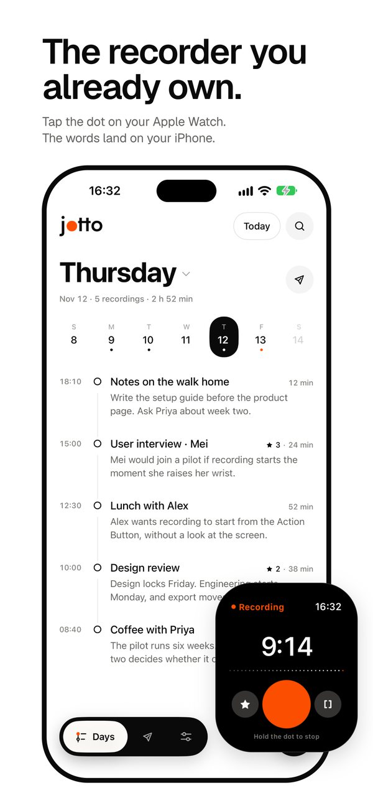
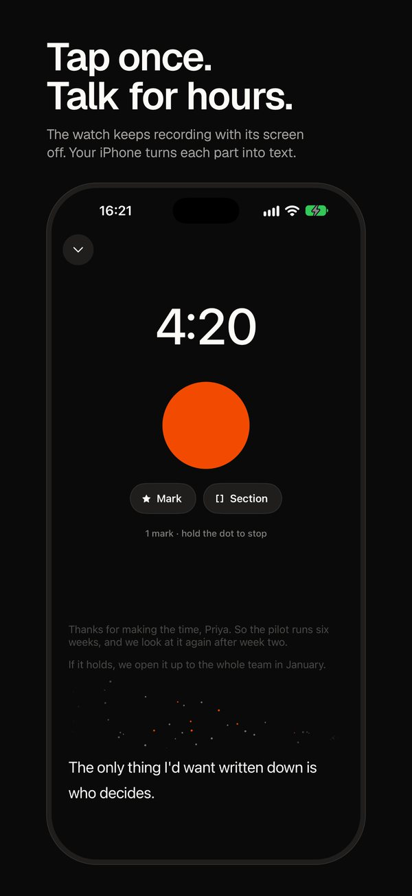
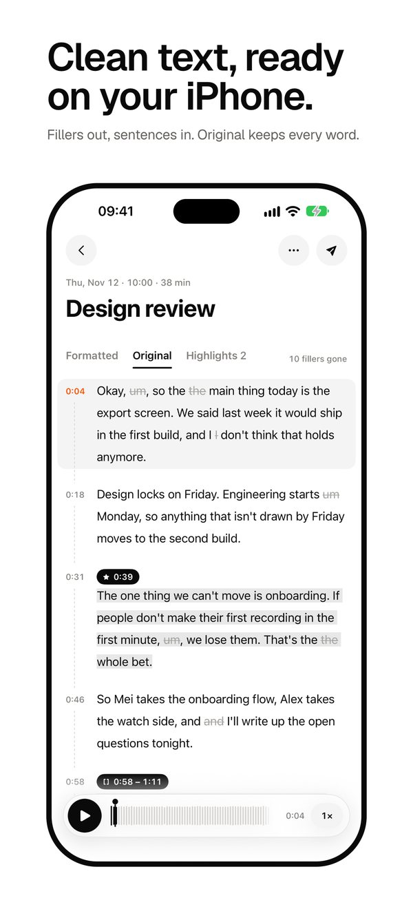
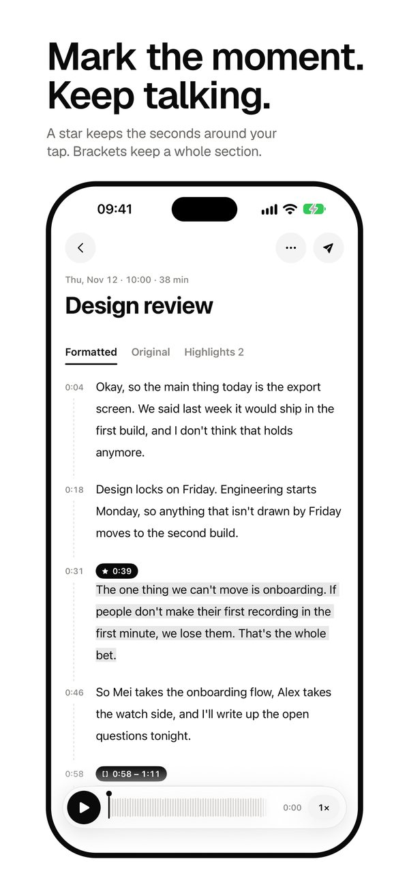
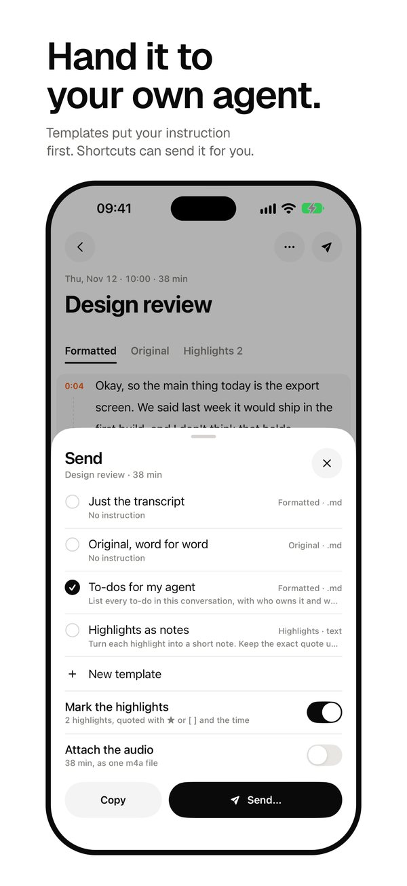
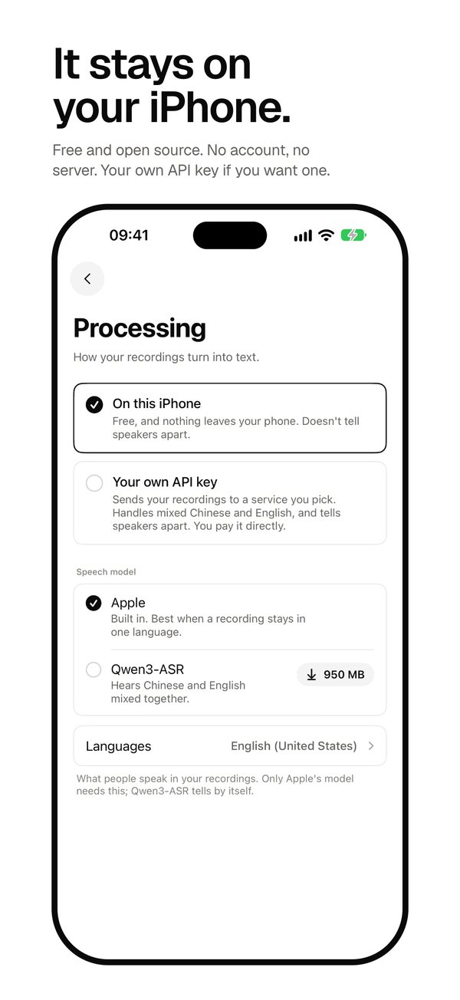

<p align="center">
  <picture>
    <source media="(prefers-color-scheme: dark)" srcset="brand/logo/final/wordmark-dark.svg">
    
  </picture>
</p>

<p align="center">
  <b>The recorder you already own.</b><br>
  Tap the dot on your Apple Watch. Clean, titled transcripts land on your iPhone.
</p>

<p align="center">
  <a href="LICENSE"></a>
  
  
  
  
  
</p>

<p align="center">
  
  
  
  
  
  
</p>

jotto turns the Apple Watch you already have into an everyday recorder. There's no new gadget to buy and nothing to set up: tap the dot on your wrist and talk. Your iPhone turns what it hears into clean text, names the recording, and keeps it ready to search, highlight and send on. There is no account and no server. Everything runs on your devices, unless you choose to bring your own API key.

jotto is free, and this repository is its full source.

## What it does

- **Records from your wrist.** Tap the dot in the watch app (a complication gets you there in one tap), or press the Action Button. The watch keeps recording with its screen off and hands the audio to your iPhone in two-minute parts. When the phone is out of reach, the parts wait on the watch and go over later. No watch on? Record on the iPhone itself.
- **Marks what matters.** A star keeps the seconds around your tap (10 before and 10 after, adjustable). Brackets keep a whole section. Both become highlights in the transcript.
- **Writes clean text.** Each part is transcribed on the iPhone as it arrives. Fillers, stutters and false starts come out; punctuation, sentences and paragraphs go in; the recording gets a title. *Original* keeps every word, with what was taken out struck through.
- **Shows the recording as it happens.** A Live screen with the time, a level strip and the latest words, plus a Live Activity on the lock screen and in the Dynamic Island.
- **Finds it later.** A day-by-day timeline, search across every recording, a Highlights tab, and playback that follows along in the text.
- **Sends it on.** Templates put your instruction first ("list every to-do, with who owns it") and the transcript after, as Markdown or plain text, for your own agent or anywhere the share sheet goes. Send one recording or a whole day, with or without the audio.
- **Works with Shortcuts.** Start, stop and mark recordings, and pass finished transcripts to Mail, Notes, ChatGPT or a folder in your Obsidian vault, automatically.

## Speech models

Pick one in Settings → Processing.

| Model | Runs | Good for |
|-------|------|----------|
| Apple | On the iPhone, built in | Up to three languages; jotto works out which one each recording is in |
| Qwen3-ASR 0.6B | On the iPhone's Neural Engine, after a 950 MB download | Chinese and English mixed in one sentence |
| Your own API key | OpenRouter, or any OpenAI-compatible service such as Groq, Together or OpenAI | Telling speakers apart; you pay the service directly |

Titles and tidying are written on the iPhone by Apple Intelligence where it's available, or by the model behind your key.

## Shortcuts

On the iPhone:

| Action | What it does |
|--------|--------------|
| Start Recording, Stop Recording | On the watch if jotto is open there, otherwise on the iPhone |
| Mark This Moment | A star in the recording going on |
| Get Finished Transcripts | Every finished recording not yet sent to a destination you name, once each |
| Get Transcript, Get Latest Transcript, Get a Day's Transcripts | A transcript laid out by one of your templates |
| Open Recording, Find Recording | Jump to a recording, or pick one by date or title |

On the watch: **Record or Mark** (starts a recording, or marks a highlight if one is going; made for the Action Button) and **Mark Without Opening**.

Transcripts come out as text for Mail or ChatGPT, and as a dated, titled `.md` or `.txt` file for Save File.

To send every recording somewhere by itself, turn on *Notify when ready* in jotto's settings. Then, in Shortcuts, add an automation for **when jotto sends a notification**, set to run immediately:

1. **Get Finished Transcripts**, with Destination *Obsidian* and the template you want.
2. **Repeat with Each** of them.
3. **Save File** into your vault (or **Send Email**, or **Ask ChatGPT**).

Each recording goes to each destination once. If a run is missed, the next one catches up.

## Privacy

- No account, no server, no analytics, no ads.
- Recordings and transcripts stay on your iPhone and watch. Audio is deleted 30 days after it's transcribed; you can make that 7 days, a year, or never.
- Nothing leaves the app unless you send it, or you use your own API key. With a key, audio and text go straight from your iPhone to that service.

The full policy is in [PRIVACY.md](PRIVACY.md). For help, see [SUPPORT.md](SUPPORT.md).

## How it's built

- **Watch:** records 16 kHz mono audio in two-minute AAC parts with `AVAudioEngine`, and sends each part to the iPhone with WatchConnectivity.
- **iPhone:** a pipeline per recording transcribes each part, cleans it (rules first, then an on-device language model), breaks it into paragraphs and writes a title. Everything is stored in the app's own folders.
- **Qwen3-ASR:** a Core ML port that runs on the Neural Engine, so it keeps working with the screen locked. The App Store version downloads the model from Apple's servers as a background asset pack; builds from source download it from Hugging Face.
- SwiftUI and Swift 6 throughout, with no third-party packages.

| Path | What |
|------|------|
| `apple/Apps/iOS` | The iPhone app: timeline, transcripts, Send, settings, the processing pipeline (`Local/`) and Shortcuts |
| `apple/Apps/Watch` | The watch app: recorder, level bars, marks, transfer to the iPhone |
| `apple/Apps/WatchWidgets` | Watch complications and the Mark control |
| `apple/Apps/LiveActivity` | Lock screen and Dynamic Island |
| `apple/Apps/Shared`, `apple/Apps/PhoneShared` | Code shared between targets |
| `apple/Apps/Assets` | The background downloader for the speech model |
| `apple/AssetPacks` | How the speech model is packed for the App Store |
| `brand/` | Logo, icons, colour tokens and illustrations |

## Build

You need a Mac with Xcode 26 and [XcodeGen](https://github.com/yonaskolb/XcodeGen).

```sh
cd apple
xcodegen generate
open Jotto.xcodeproj
```

To run it on your own iPhone and watch, change these in `apple/project.yml` (and in the entitlements files it points to):

- `DEVELOPMENT_TEAM`, to your own team
- the bundle identifiers, `com.neethanwu.jotto…`
- the app group, `group.com.neethanwu.jotto`

## Licence

GPLv3, with an additional permission that lets jotto be distributed through app stores. See [LICENSE](LICENSE) and [NOTICE](NOTICE).

The jotto name, wordmark and icons aren't covered by the licence. If you publish your own version, give it its own name and icons.

## Thanks

jotto's speech model is [Qwen3-ASR](https://huggingface.co/Qwen/Qwen3-ASR-0.6B) by the Qwen team at Alibaba Cloud, in the [Core ML export](https://huggingface.co/aufklarer/Qwen3-ASR-CoreML) by aufklarer. The code that runs it is adapted from [speech-swift](https://github.com/soniqo/speech-swift). All three are under the Apache License 2.0.

Built by neethan.
